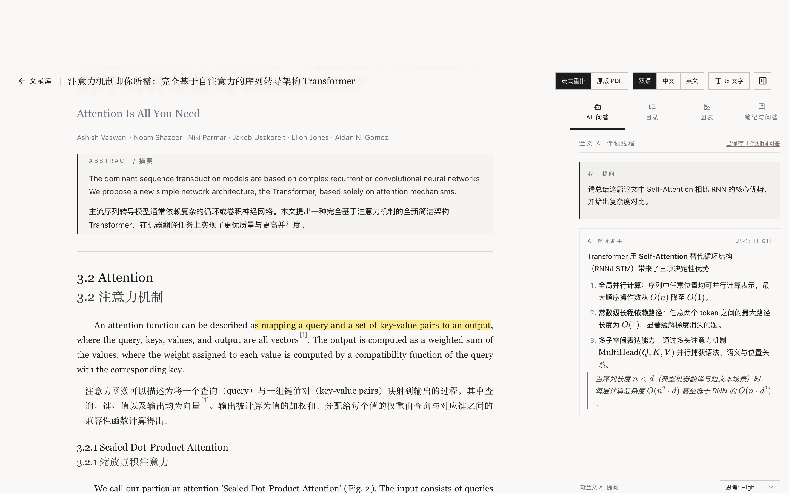
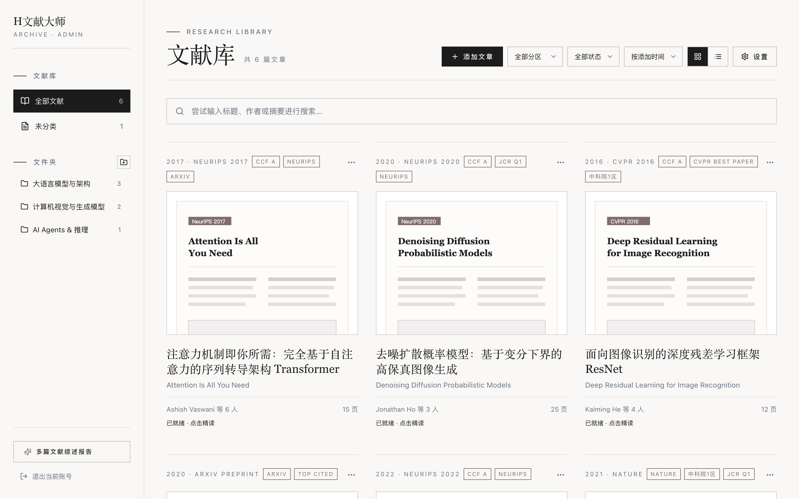
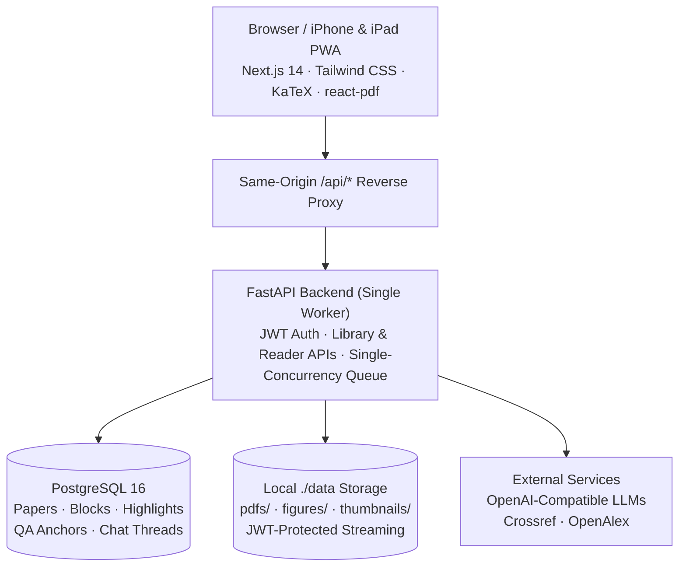

<div align="center">

# H文献大师 · H-Academic-Reading

**编辑杂志风自托管 AI 学术文献流式阅读与管理平台**

*Editorial-style self-hosted AI academic paper reading & management platform — built for desktop browsers and iOS/iPadOS Safari PWA with real-time cloud sync.*

[](https://nextjs.org/)
[](https://fastapi.tiangolo.com/)
[](https://www.postgresql.org/)
[](https://docs.docker.com/compose/)
[](#多端访问与-pwa-安装)
[](#自托管-docker-快速部署)

[界面预览](#界面预览) · [核心特性](#核心特性) · [多模型配置](#多模型分模块配置) · [系统架构](#系统架构) · [快速部署](#自托管-docker-快速部署) · [环境变量](#环境变量说明) · [PWA 指南](#多端访问与-pwa-安装)

</div>

---

## 简介

**H文献大师（H-Academic-Reading）** 是一款面向个人科研与深度阅读场景的自托管 AI 学术文献平台。系统采用克制、高辨识度的 **「编辑杂志风（Editorial Magazine Style）」** 视觉语言，将 PDF 论文解析为可流式重排的双语学术版面，并原生支持 **PC 桌面端** 与 **iPhone / iPad Safari PWA** 跨设备实时云端同步。

整个后端与容器编排针对 **2 核 4GB 内存** 轻量级云主机进行深度内存优化，默认集成阿里云百炼（DashScope OpenAI 兼容接口），也可随时在前端设置页无缝切换任意 OpenAI 兼容大模型服务。

---

## 界面预览

### 沉浸式双语流式精读 & AI 伴读
> 双语对照流式排版、LaTeX 数学公式渲染、多色荧光高亮与批注、右侧 AI 伴读与段落锚点持久化问答。

<p align="center">
  
</p>

### 编辑杂志风个人文献库
> 暖米纸底色与 1px 发丝线排版、多级文件夹归类、中科院 / JCR / CCF 期刊分区徽章与实时解析进度追踪。

<p align="center">
  
</p>

---

## 核心特性

### 1. 编辑杂志风与沉浸式阅读体验
- **克制的视觉体系**：暖米纸底色 `#f9f8f6`、墨黑正文 `#1c1c1c`、石墨次要字色 `#6b7280` 与陈玫点缀 `#816d70`，全站直角布局配 `1px` 发丝线分隔，消除界面噪音。
- **灵活的阅读视图**：支持 **流式重排 / 原版 PDF** 一键切换，提供 **双语对照 / 纯中文 / 纯英文** 三种模式；自由调节字号、行距、版心宽度及衬线/无衬线字体。
- **学术排版与交互增强**：
  - 自动合并同页断行并去重相同双语标题，还原自然连贯的段落流。
  - 正文自动识别 `Fig. X` / `Table X` 与 `[1]` 参考文献角标（统一上标渲染），点击原地弹出高清图表、双语图注或文献引用卡片。
- **跨设备阅读进度同步**：自动持久化记录流式段落块位置与原版 PDF 页码，在 Mac、Windows、iPhone 与 iPad 间切换时自动恢复上次阅读位置。

### 2. 低内存单并发逐页 AI 解析引擎
- **2C4G 友好内存控制**：后台异步解析队列严格限制并发数为 `1`，逐页渲染 PDF、识别双栏阅读顺序并转换为标准 LaTeX 公式（`$...$` / `$$...$$`）；每页完成图表裁剪后立即释放文件句柄并执行 `gc.collect()` 回收内存。
- **自动元数据与期刊分区识别**：结合 PDF 首页文本、Crossref / OpenAlex API 与 LLM 结构化输出，自动补全中英文标题、作者、年份、发表期刊及 **期刊分区徽章**（中科院分区 / JCR 分区 / CCF 等级 / arXiv）。
- **文献库分类管理**：支持多级文件夹归类、解析进度实时追踪与焦点自动同步。

### 3. 划词伴读、6 色高亮与「段落锚点 AI 对话持久化」
- **跟随滚动的划词工具条**：选中正文任意英文或中文片段，工具条精准锚定于选区正上方并随正文滚动，支持 **`AI 解释`**、**`问问 AI`**、**`翻译`**（支持就地更新并保存段落译文）与 **`高亮`**。
- **6 色荧光高亮与云端批注**：提供 6 种清晰柔和的荧光配色，支持直接覆盖更改高亮颜色；点击已高亮文本即可随时编辑批注或移除高亮。
- **段落锚点 AI 问答持久化（QA Anchor）**：发起 `AI 解释` 或 `问问 AI` 后，系统将 `qa_anchor` 锚点及完整多轮问答持久化保存至数据库，并在正文对应文字下方渲染陈玫色虚线与星标角标；AI 回复原生支持 **Markdown + LaTeX 公式渲染**，跨端重新打开论文点击角标即可回溯原文上下文并继续追问。

---

## 多模型分模块配置

三个核心 AI 模块相互独立，均可在 **前端设置页** 随时修改 `Base URL`、`API Key`、模型名称并一键测试连通性（兼容阿里云百炼及其他 OpenAI 兼容 API）：

| 功能模块 | 默认模型 | 核心职责 | 专属选项 |
| :--- | :--- | :--- | :--- |
| **视觉重排与图表解析** | `qwen3.5-ocr` | 逐页识别双栏版面顺序、LaTeX 公式还原与图表边界框裁剪 | 支持独立 Base URL / API Key |
| **全文翻译与元数据提取** | `deepseek-v4.1-flash-1017` | 后台整篇并发段落翻译、中英文摘要及期刊分区结构化提取 | 支持独立 Base URL / API Key |
| **AI 伴读与划词深度解释** | `deepseek-v4.1-flash-1017` | 全文侧边栏伴读、划词解释与段落锚点多轮追问 | 支持调节思考强度 `high` / `medium` / `low` |

---

## 系统架构



### 技术栈一览

| 层级 | 技术选型 |
| :--- | :--- |
| **前端** | Next.js 14 (App Router), React 18, TypeScript, Tailwind CSS, KaTeX, react-pdf, Lucide Icons, Service Worker PWA |
| **后端** | Python, FastAPI, SQLAlchemy 2.0, Pydantic v2, PyJWT, HTTPX, PyMuPDF (`fitz`), Pillow |
| **数据库** | PostgreSQL 16 (Alpine) |
| **部署** | Docker, Docker Compose, GitHub Actions (GHCR 自动构建) |

### 目录结构

```text
H-Academic-Reading/
├── backend/                  # FastAPI 后端服务与单并发 PDF 解析引擎
│   ├── app/
│   │   ├── routers/          # auth / papers / folders / reader / files / settings
│   │   └── services/         # pdf_worker / llm_service / metadata_service
│   ├── Dockerfile
│   └── requirements.txt
├── frontend/                 # Next.js 14 前端与 PWA 资源
│   ├── public/               # manifest.json / sw.js / PWA 图标
│   ├── src/
│   │   ├── app/              # App Router 页面与 /api/[...path] 代理
│   │   └── components/       # LibraryView / PdfOriginalViewer / MathText / SettingsModal
│   └── Dockerfile
├── docker-compose.yml        # 本地源码构建编排
├── docker-compose.prod.yml   # 生产环境预构建镜像编排（含 2C4G 内存限额）
└── .env.example              # 环境变量配置模板
```

---

## 自托管 Docker 快速部署

> **前置要求**：已安装 Docker 与 Docker Compose v2，服务器建议 **2 核 4GB 内存** 及以上。

### 方式一：使用预构建镜像（推荐 2C4G 云主机）

`docker-compose.prod.yml` 已为各容器预设内存上限（PostgreSQL `512m` / Backend `1800m` / Frontend `768m`），适合轻量级云主机直接拉取运行：

```bash
git clone https://github.com/wy165611/H-Academic-Reading.git
cd H-Academic-Reading

cp .env.example .env
# 编辑 .env，务必修改 ADMIN_PASSWORD、JWT_SECRET、POSTGRES_PASSWORD 与 DEFAULT_LLM_API_KEY

mkdir -p data/pdfs data/figures data/thumbnails
docker compose -f docker-compose.prod.yml up -d
```

更新到最新版本：

```bash
docker compose -f docker-compose.prod.yml pull
docker compose -f docker-compose.prod.yml up -d
```

### 方式二：本地源码构建

适合二次开发或自定义镜像构建：

```bash
git clone https://github.com/wy165611/H-Academic-Reading.git
cd H-Academic-Reading

cp .env.example .env
mkdir -p data/pdfs data/figures data/thumbnails
docker compose up -d --build
```

---

## 环境变量说明

复制 `.env.example` 为 `.env` 后按需配置：

| 变量名 | 必填 | 默认值 | 说明 |
| :--- | :---: | :--- | :--- |
| `ADMIN_USERNAME` | 否 | `admin` | 管理员登录用户名 |
| `ADMIN_PASSWORD` | **是** | — | 管理员登录密码（生产环境请设为强密码） |
| `JWT_SECRET` | **是** | — | JWT 签名密钥（建议 32 位以上随机十六进制字符串） |
| `JWT_EXPIRE_HOURS` | 否 | `168` | 登录令牌有效期（小时，默认 7 天） |
| `POSTGRES_USER` | 否 | `scholaread` | PostgreSQL 用户名 |
| `POSTGRES_PASSWORD` | **是** | — | PostgreSQL 数据库密码 |
| `POSTGRES_DB` | 否 | `scholaread` | PostgreSQL 数据库名 |
| `DEFAULT_LLM_BASE_URL` | 否 | `https://dashscope.aliyuncs.com/compatible-mode/v1` | 全局默认 LLM API 地址（OpenAI 兼容） |
| `DEFAULT_LLM_API_KEY` | 推荐 | — | 全局默认 LLM API Key（也可在启动后于前端设置页配置） |
| `DEFAULT_VISION_MODEL` | 否 | `qwen3.5-ocr` | 默认视觉重排与图表解析模型 |
| `DEFAULT_TRANSLATE_MODEL` | 否 | `deepseek-v4.1-flash-1017` | 默认全文翻译与元数据提取模型 |
| `DEFAULT_CHAT_MODEL` | 否 | `deepseek-v4.1-flash-1017` | 默认 AI 伴读与划词解释模型 |
| `DEFAULT_CHAT_THINKING_LEVEL` | 否 | `high` | 伴读模型默认思考强度（`high` / `medium` / `low`） |
| `MAX_UPLOAD_MB` | 否 | `60` | 单篇 PDF 最大上传体积（MB） |
| `PDF_RENDER_DPI` | 否 | `200` | PDF 页面渲染分辨率（DPI） |

---

## 多端访问与 PWA 安装

1. 容器启动后，在浏览器访问 `http://<你的服务器IP>:3000`（建议配合 Nginx / Caddy 反代并开启 HTTPS）。
2. 使用 `.env` 中配置的 `ADMIN_USERNAME` 与 `ADMIN_PASSWORD` 登录。
3. **iOS / iPadOS 全屏 PWA**：使用 Safari 打开站点后，点击底部/顶部 **「分享」→「添加到主屏幕」**，即可获得接近原生 App 的全屏无地址栏沉浸式学术阅读体验。
